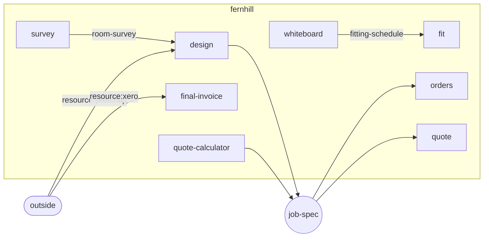

# Fernhill Kitchens: where the margin goes, and four projects to get it back

*A demo engagement. Fernhill Kitchens, its people and its numbers are made up; the method, the measurements and
the verdict below are real runs of Morphogen on that material.*

**For:** Sian Hollis, managing director. **From:** the material in `material/` (an overview, the office handbook,
the systems list, the quote calculator, the job sheet export of 121 jobs from January 2025, and a 50-minute
interview on 2026-11-21). **How:** the firm mapped as files (`catalog-info.yaml`, `catalog/`), every claim tied
to its source; the numbers computed by `analysis/baseline.py` (output: `analysis/baseline.txt`); the quote
calculator turned into a cell and judged by Morphogen on jobs it never saw.

## In one paragraph

The firm quotes 35% on cost and gets 16%. The quote calculator's costs are too low on every one of the 50
completed jobs, by a median 14%, because its constants date from March 2023. That is about **£84,000 of
margin over those 50 jobs, about £53,000 a year**. Corrected constants, found by search and checked on 19 jobs
held back from that search, bring the calculator's error from 12.4% to 3.4%. Separately, quotes take a median
9 days, and the job sheet shows the win rate falling with every week a quote waits: 80% when the quote goes
within 5 days, 32% at 10 to 14 days, none of 16 at 15 days or more. Fitting starts slip on half the jobs and
the final invoice goes a median 12.5 days after the fit. The four projects below are in the order we would do them.

## What we found

| Measure | Now | Source |
| --- | --- | --- |
| Markup on cost, intended | 35% | `material/quote-calculator.md` (B18); the interview |
| Markup on cost, realised (median, 50 completed jobs) | 16.3% | `analysis/baseline.txt` |
| Jobs whose cost the calculator under-estimated | 50 of 50 | `analysis/baseline.txt` |
| Margin short of the intended, 50 jobs fitted March 2025 to October 2026 | £83,576 | `analysis/baseline.txt` |
| Survey to quote, median | 9 days (17% within 5) | `analysis/baseline.txt` |
| Win rate by days to quote: 0-5 / 6-9 / 10-14 / 15+ | 80% / 57% / 32% / 0% (n = 20 / 44 / 34 / 16) | `analysis/baseline.txt` |
| Lost jobs where the customer said they went with a quicker quote | 15 of 62 | `analysis/baseline.txt` |
| Fitting starts later than first planned | 48% (median 5.5 days late when late) | `analysis/baseline.txt` |
| Fit signed off to final invoice, median | 12.5 days | `analysis/baseline.txt` |
| Jobs with remade cabinets | 6 of 50 (12%), 5 from survey measurement | `analysis/baseline.txt` |

One stated figure the data does not bear out: remakes were put at "one job in five" in the interview; the job
sheet shows one in eight. Worth knowing before spending on it.

What must not change (the interview): the workshop and its doors; the 35% margin; anything the fitters use must
work on their own Android phones and be simple; no new hire to run a system; software "a few hundred a month if
it earns it"; a project that pays back inside a year.

## The map

The firm as files: the System, five teams, the steps a job goes through, the tools behind them, the interfaces
work is handed on by, and the roles a tool plays (so another tool could play them). Rendered by Morphogen
(`analysis/map.mmd`):

Of six interfaces, one (`job-spec`, the calculator's) has tests; the rest are named, not yet enforced.

## Project 1: a quote calculator that knows what jobs cost

**What changes.** The calculator's cost constants, which have not moved since March 2023, while carcass prices
rose in summer 2025 (the interview) and labour per cabinet was under-counted. Then a quarterly check: the
calculator's cost for each completed job against what the job cost (supplier bills coded to the job in Xero,
timesheet hours), which the firm already records and nobody compares.

**The target and its measure.** The calculator's cost within 5% of the actual, on average, on completed jobs it
was not fitted to. Measured by `cells/quote/score.py`: the mean absolute error as a share of actual cost.

**Where it stands.** The calculator is a cell (`catalog/quote.yaml`): its formula in `cells/quote/estimate.py`,
the six cost constants free to move within bounds, the margin and the labour rate held fixed (they are the
firm's decisions), and interface tests that any version must pass (price = cost + 35% to £10; more cabinets or
worktop never cost less; premium and quartz cost more; jobs it cannot price are refused). Morphogen searched the
constants on 31 completed jobs and judged the best on 19 held back:

| | v7 sheet | Tuned | |
| --- | --- | --- | --- |
| Mean cost error, 19 held-out jobs | 12.4% | **3.4%** | judged: **pass**, 7 runs, sign test p = 0.008, in a Podman sandbox |
| Premium carcass | £340 | £402.50 | |
| Hours per cabinet | 5.5 | 7.75 | |
| Other constants | | unchanged | |

**Read the tuned values as a fit, not as prices.** The search moved two constants to absorb every error,
including the Standard carcass price rise it left alone. The project should therefore (1) enter Lindale's and
Stonecraft's current prices from their price lists, (2) give each worktop material its own waste allowance (the
sheet has one for all three), and (3) fit only the labour and waste constants to completed jobs. Each of these is
a change to the cell, judged the same way before it is used.

**What it is worth.** Up to about £53,000 a year at the current volume, the margin the firm intends to charge and
does not. Not all of it will be kept: quoted prices rise by about 15% on the same jobs, and some customers will
go elsewhere. The win rate after the change is the second measure to watch.

**Cost and risk.** About two days: the prices entered, the sheet changed and checked against the cell, the
quarterly comparison set up as a saved report. Risk: higher quotes cost jobs (watch the win rate monthly; the
margin is Sian's to hold, the report only shows what it costs); the fit is only as good as the job coding in Xero
(started January 2025).

## Project 2: quotes in three days

**What changes.** The quote stops waiting for the designer to rebuild it by hand. With project 1's calculator
trusted, the designer enters the four inputs during or right after the survey (on the tablet or phone they
already carry) and the quote PDF is filled from the template; the design rounds go on after the price is agreed in
principle, not before.

**The target and its measure.** Median survey-to-quote 3 days (now 9), and at least 80% within 5 (now 17%), from
the job sheet's `survey_date` and `quote_sent_date`. Then the win rate by days to quote, monthly.

**What it is worth.** The job sheet shows the link, not its cause: busy months make quotes slow and may lose jobs
for other reasons too. 15 of the 62 lost customers said they went with a quicker quote. If a third of those
jobs had been won, that is 5 kitchens, about £60,000 of work over 21 months at the average job's £12,400. The
first month of the trial will say whether the win rate moves.

**Options.** Not catalogued yet: the calculator on a phone (the sheet in Google Sheets, or the quote module of
the scheduling tool chosen in project 3, since all three options quote). Decide after project 3's trial.

**Cost and risk.** Low: a change to how the designers work, a day to set up. Risk: a price given before the
design rounds needs a stated margin for changes, and the designers have to agree to it.

## Project 3: a schedule the fitters can see

**What changes.** The whiteboard, its photos and the WhatsApp groups give way to one schedule: each job's fitting
pair, address, days, the quartz template visit, the parts due, on the fitters' phones; the final invoice raised in
Xero the day the job is signed off, from the same tool.

**The target and its measure.** Fitting starts that slip: under 20% (now 48%). Double-bookings: none (two this
year, the interview). Sign-off to final invoice: 2 days (now a median 12.5); the 60% balance averages £7,500 a job.

**Options catalogued** (`catalog/scheduling.yaml`, each with what its vendor's page says, quoted):

| Option | Price for 9 people | Android | Xero | Multi-day fitting schedule |
| --- | --- | --- | --- | --- |
| Fergus | £405 a month, or £273 if fitters can be timesheet users (to check) | stated | invoices, payments, contacts | not stated: to test |
| Tradify | £333 a month (Pro, £37 a user) | stated | invoices, payments, credit notes, 2-way | not stated: to test |
| ServiceM8 | £25 or £59 a month, any number of users, by job volume | stated, iOS first | invoices, payments | not stated: to test |
| Shared Google calendars | already paid for, plus 4 accounts | yes | none | yes, by hand |
| Ruled out: anything self-hosted | | | | "We would rather not run a server" |

None was measured yet. **The trial, before choosing:** each of the three in its free trial, replaying three past
months of fitting weeks from the job sheet with the two pairs, and checking a multi-day booking, the quartz
template visit, the fitter's view on an Android phone and the invoice reaching Xero. Mark and one fitting pair
judge the phone side; Dee the office side. We would start with Tradify or Fergus (Android stated plainly, per-user
pricing inside the budget) and keep ServiceM8 if its Android app passes the fitters.

**Cost and risk.** £250 to £400 a month; about a week of Dee's time to move the jobs over and a morning per
fitting pair to learn it. Risk: the fitters do not use it, so the trial runs with them, and the whiteboard stays
until a month of fitting has gone through the new tool without a miss.

## Project 4: fewer remakes (smaller, later)

6 of 50 completed jobs had cabinets remade, 5 because of survey measurements. A laser measure that records into
the survey (instead of a tape and pencil), and a check of the drawing against it before ordering, would address
most of them. Worth about a day of someone's time per remake; catalogue the measuring tools once projects 1 to 3
are under way.

## What we did not look at

Supplier terms, the workshop's own efficiency (off limits by choice), marketing, and the year's accounts. Six
interfaces were named and one tested; the fitting schedule's interface (`fitting-schedule`) is inferred and to be
confirmed with Mark.

## How to check this report

Every claim in the map carries its source as `trust | file:line or URL | "quote"`. `python
analysis/baseline.py material/jobs.csv` reproduces every number in the table. The verdict is in Morphogen's
evidence log (`morphogen evidence`); `morphogen status` shows the cell and its pass.
